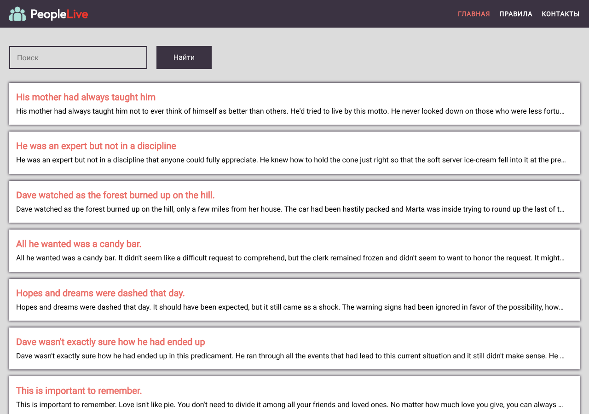

# Блог — список статей с поиском и пагинацией

Одностраничное приложение на Vue 3: лента статей, поиск, постраничная навигация и страница отдельной статьи. Данные приходят с открытого API [dummyjson.com](https://dummyjson.com/posts).



## Что реализовано
- Список статей с карточками (10 на страницу)
- Поиск по статьям через запрос к API
- Пагинация
- Маршрутизация (Vue Router): главная, страница статьи `/blog/:id`, контакты, правила
- Ленивая загрузка страниц, общие стили на Less с переменными и миксинами

## Стек
Vue 3 · Vue Router · Pinia · Axios · Vite · Less

## Запуск
```bash
npm install
npm run dev      # http://localhost:3000
npm run build    # сборка в dist/
```

## Структура
```
src/
├── components/   ListArticles, SearchForm, ThePagniator, CardArticle
├── pages/        index, blog/[id], contacts, rules
├── router/       маршруты
└── styles/       переменные, миксины, анимации
```

## Автор
Алина Штауб — [портфолио в Figma](https://www.figma.com/)
